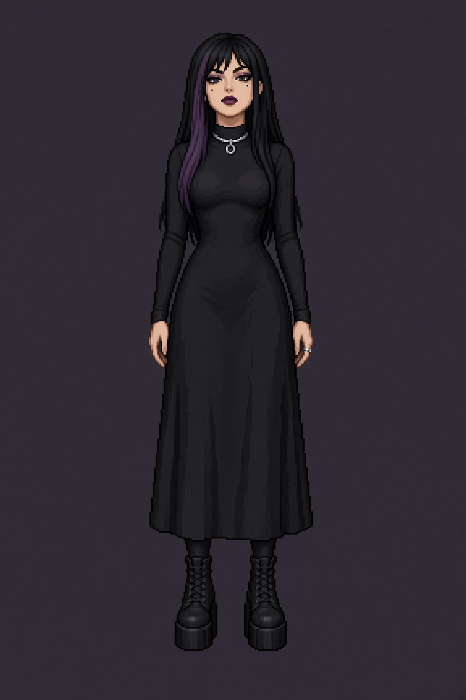
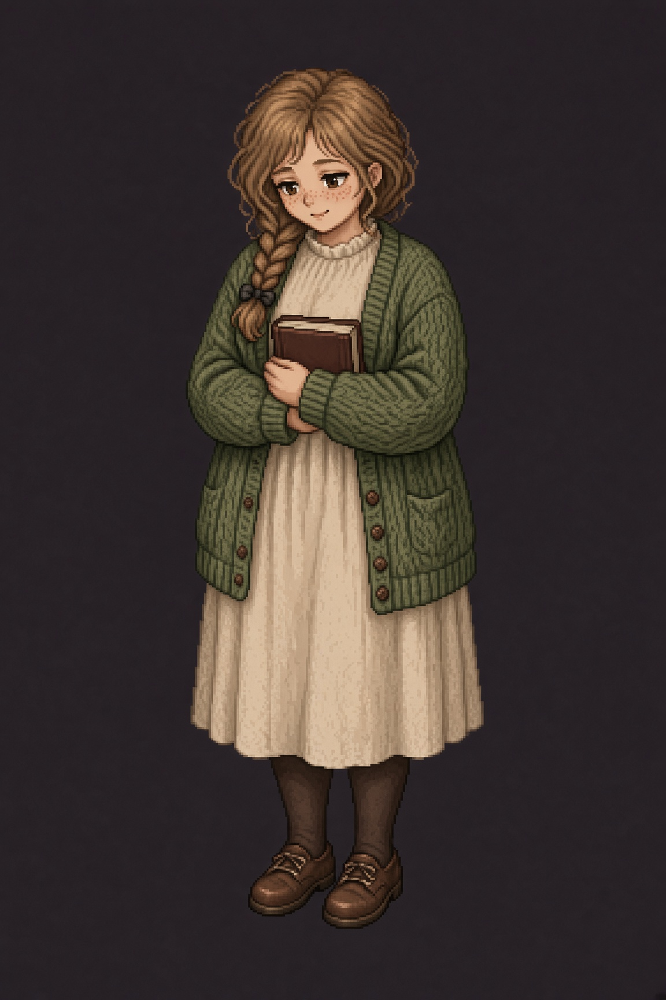
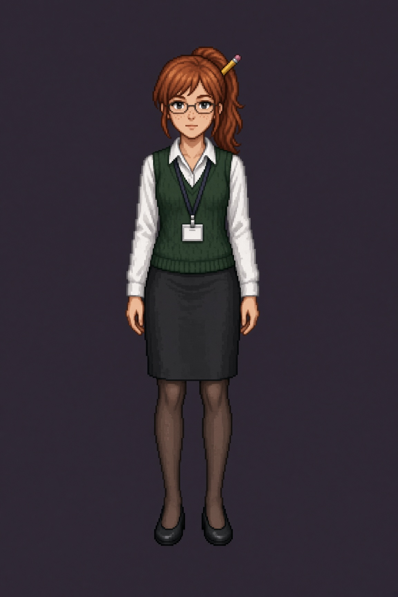

# Vizuális biblia

A játék pixelgrafikás. Ezek a referenciák nem a végleges sprite-ok. Részletes, pixeles illusztrációk, hogy a három lány arca, haja, ruhája és testalkata ugyanaz maradjon, amikor később új képet generálunk vagy megrajzoljuk őket a játék rácsára.

Ha egy új kép és ez a lap ütközik, ez a lap nyer. A képet újra kell generálni, nem a kanont igazítani a hibához.

## A három horgony







## Közös stílus

- Nézet: egész alak, szemből, mindkét láb látszik, üresen áll, a kamera nem alulnézet.
- Kor: felnőtt arc és testarány. Nem chibi, nem nagy fej, nem gyerekarc.
- Ruha: az alapruha zárt. Nincs fürdőruha, nincs fehérnemű, nincs meztelen váll „csak mert gót”.
- Háttér a referencián: lapos `#2c2830`. A játék hátterei később külön készülnek.
- Körvonal a végleges sprite-on: 1 pixel, `#1a1214`, nem tiszta fekete.
- Nincs szöveg, vízjel, keret, több póz egy lapon, amíg külön nem kérjük.
- A három lány sosem áll egy generálásban együtt. Külön kép, külön prompt, hogy az arcuk ne olvadjon össze.

A végleges játékfelbontás szigorúbb, mint ezek a fotós-pixel hibridek. Háttér 320×180. Figura a játékban nagyjából 64–80 pixel magas, egész számú nagyítással. Addig ezek a lapok a karakterek azonossága, nem az exportméret.

## Paletta

A hexák a kanonikus színek. A generált kép közelíthet, a következő promptba ezeket kell beírni.

**Rebeka.** Haj `#1a1420`. Szilvatincs `#6e3a52`. Bőr `#f0d2c4`. Száj `#6e2438`. Ruha `#16141c`. Ezüst `#c9cdd4`. Csizma `#221c18`.

**Boglárka.** Haj `#8a5a3a`. Bőr `#f3d0b8`. Szeplő `#c48462`. Kardigán `#5e7a58`. Ruha `#f4ead8`. Könyv `#6a3a32`. Cipő `#6b5344`.

**Gréta.** Haj `#c4542a`. Bőr `#f6d7c4`. Mellény `#1f4a3a`. Ing `#f7f4ee`. Szoknya `#3a3e46`. Szemüvegkeret `#2a2e33`. Ceruza `#e2b84a`.

## Eltérések a jelenlegi képeken

Ezeket a következő generálásnál ki kell javítani, nem átvenni:

- A képek lágyabbak és festőiebbek, mint a cél. A cél kemény pixel, kevés szín, életlen élek nélkül.
- Rebeka kulcslyuka a gallérnál rajta van a képen. Megmarad, de kicsi: nem dekoltázs, nem kivágott mell.
- Boglárka első generálása kerek szemüveget kapott. Az nem kanon. A lentebb hivatkozott kép már szemüveg nélkül készült. Neki nincs szemüvege. Szemüvege csak Grétának van, és az téglalap.
- Egyik képen se legyen második személy, tükör vagy árnyék-iker.

## Azonosság, amit tilos cserélni

| | Rebeka | Boglárka | Gréta |
| --- | --- | --- | --- |
| Haj | fekete, egyenes, hosszú, bal oldali szilvatincs | világosbarna laza copf a jobb vállon | rézvörös magas lófarok, sárga ceruza |
| Arcjel | bal szem alatti anyajegy, sötét száj | kerek arc, szeplő, nincs szemüveg | téglalap szemüveg, orrszeplő |
| Ruha | fekete midiruha, karika-nyakék, platformcsizma | mohazöld kardigán, ekrü ruha, könyv két kézben | fehér ing, erdőzöld mellény, grafitszoknya, belépőkártya |
| Test | magas, nőies, hangsúlyos derék és csípő | alacsony, telt | közepes, karcsú |

Ha egy jelenet másik ruhát kér (éjszaka kabát, eső), a haj, az arcjel és a testalkat akkor is ez marad. A ruha cseréjét a prompt végére kell írni, az alapruha mondata helyére, nem a karakter többi mondata helyére.

## Prompt, másoláshoz

Minden új kép ezzel a bevezetővel indul. Utána jön a lány blokkja. A végére csak az adott kép különbsége kerül: arckifejezés, ruha, helyszín.

**Bevezető**

```text
Pixel art character reference, one adult woman, full body front view,
both feet visible, centered, standing. 32-bit JRPG sprite, crisp hard
pixels, limited palette, no blur, no anti-aliasing, no text, no watermark,
no second person. Plain flat background #2c2830. Fully clothed, modest,
no nudity, no lingerie, adult proportions, not a child, not chibi.
```

**Rebeka Dorn**

```text
Rebeka Dorn, age 20. Tall, 172 cm, curvy feminine hourglass, pale skin #f0d2c4.
Long straight black hair #1a1420 to the waist, one dull plum streak #6e3a52
on her left side. Sharp eyeliner, dark berry lipstick #6e2438, small beauty
mark under her left eye. Modest long-sleeved high-neck black midi dress #16141c
with only a small keyhole at the collar, silver ring choker #c9cdd4, long black
skirt, chunky black platform boots, one silver ring. Arrogant calm, chin slightly raised.
```

**Boglárka Fazekas**

```text
Boglarka Fazekas, age 19. Short, 158 cm, chubby soft round build, round face,
freckles #c48462, no glasses, no eyewear. Light brown hair #8a5a3a in a loose
braid over her right shoulder. Shy expression, eyes slightly lowered, face visible.
Oversized moss-green cardigan #5e7a58, cream high-neck dress #f4ead8 to mid-calf,
dark tights, brown canvas shoes #6b5344, both arms holding a closed hardcover
book #6a3a32 against her chest.
```

**Gréta Váradi**

```text
Greta Varadi, age 21. Slim, 168 cm, copper-red hair #c4542a in a high ponytail
with a yellow pencil #e2b84a stuck through the hair tie. Thin rectangular glasses
#2a2e33, light freckles across the nose, fair skin #f6d7c4, focused neutral mouth.
White button shirt #f7f4ee, dark forest-green knit vest #1f4a3a, charcoal
knee-length skirt #3a3e46, dark tights, simple black flats, short lanyard
with a blank ID card.
```

**Különbség, példa.** Egy későbbi esőudvar-képnél a bevezető és a lány blokkja változatlan, a végére csak ennyi kerül: `Same person, same hair, same face marks, same body. Outfit unchanged under an open dark coat. Expression: surprised, not smiling. Background: pixel art college courtyard after rain, no other people.`

## Arckifejezés-lista a későbbi sprite-okhoz

Még nem kell legyártani. Ha sor kerül rá, lányonként külön kép, ugyanebből a promptból, csak az utolsó mondat cserélődik.

- Rebeka: semleges gőg, félmosoly, unalom, csendes düh, meglepetés, rövid zavar festék nélkül, lesütött szem.
- Boglárka: szégyenlős semleges, kis mosoly, elpirulás, ijedtség, őszinte nevetés, megbántottság, elszántság.
- Gréta: koncentrált semleges, kis mosoly, összevont szemöldök, meglepetés, zavar, fegyelmezett düh, elkapott nevetés.

Az expressziós képen a ruha és a haj nem változhat. Festék nélkül csak Rebeka egyetlen, megnevezett zavar-képe.

## Főhős és háttér

Mártonnak még nincs referenciája. Amíg a vonásai nincsenek lerögzítve, nem generálunk hozzá képet, hogy ne legyen két hivatalos arca.

A helyszínek (tanszéki előtér, könyvtár, Holdkör, udvar) külön lapot kapnak, ha a jelenetvázlat megvan. Addig nem készül háttér, hogy ne egy üres folyosó váljon kanonná.
