# Ligetvár location concepts — 28 October 2026

User direction: preserve a drawn anime look and use the player's first-person viewpoint for scene backgrounds. These sixteen generated concept candidates supersede the earlier realistic drafts. They are not runtime replacements or user-approved architectural masters. No generated candidate was used as a chained reference. Each image was generated independently from the written spatial brief; selected outputs were exported as WebP quality95. Original generated PNGs remain in their image-generation outputs. Exact prompts, embedded exclusions, source/output hashes and dimensions are in [manifest.json](manifest.json).

The overview and four-floor location map are reproducible SVG illustrations based on the authoritative geometry, rendered by `tools/render-concept-maps.py`; PNG exports use Inkscape. Floor panels all use equal x/y scale and the same scale across panels. These are scene-location envelopes, not complete construction drawings or fully resolved circulation plans. Vegetation symbols are illustrative.

## Maps

[Estate and regional inset](maps/estate-stylized.svg) · [Castle floor layers](maps/castle-floors-stylized.svg)

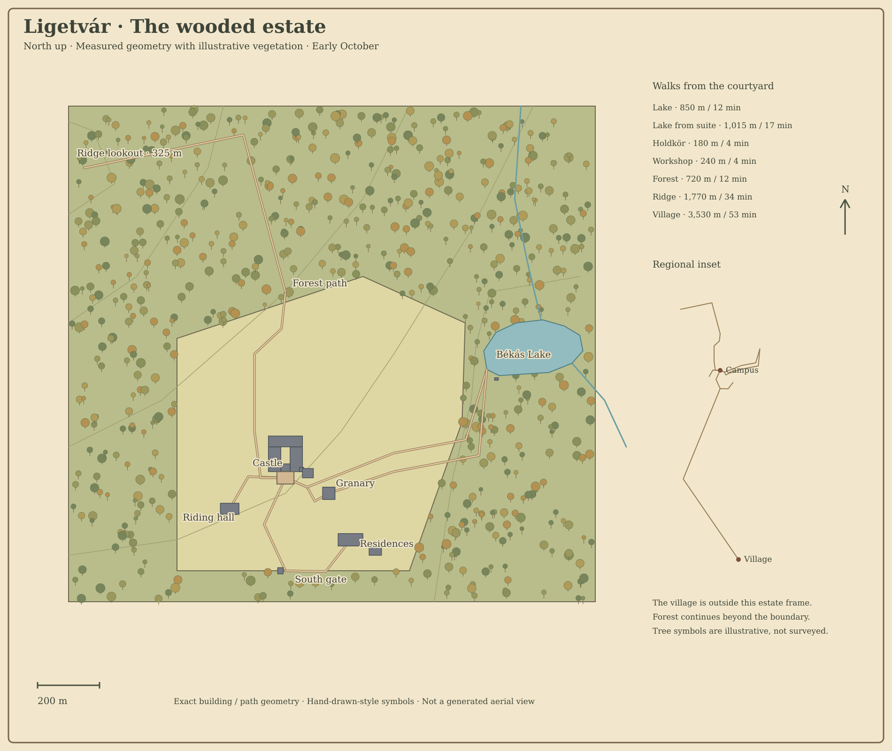

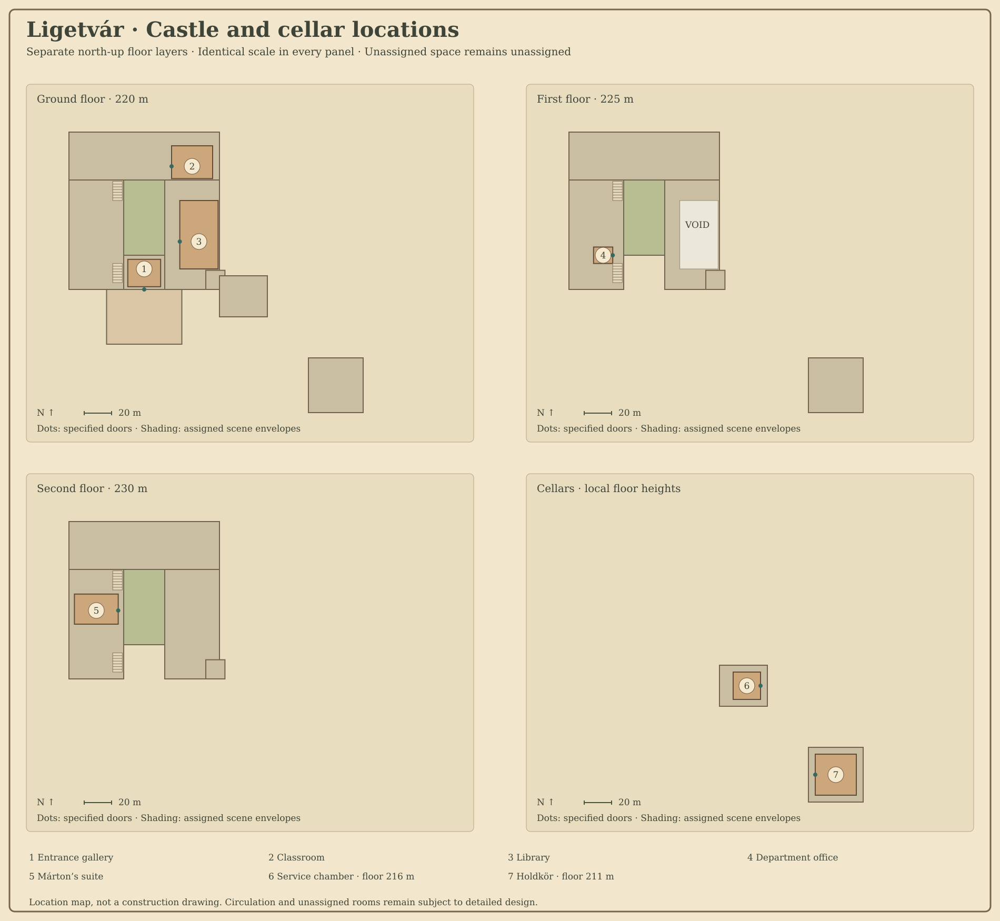

## Location gallery

| Location | Concept |
| --- | --- |
| Castle exterior | 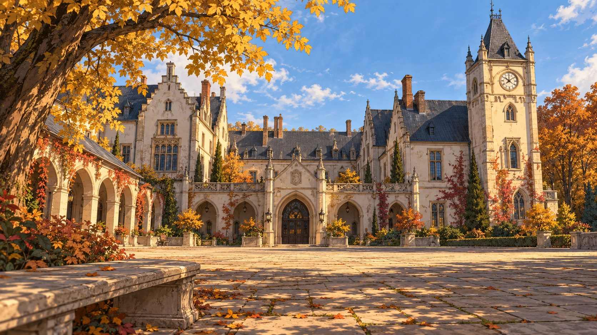 |
| Courtyard | 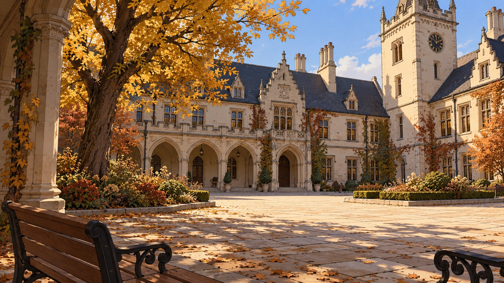 |
| Entrance gallery | 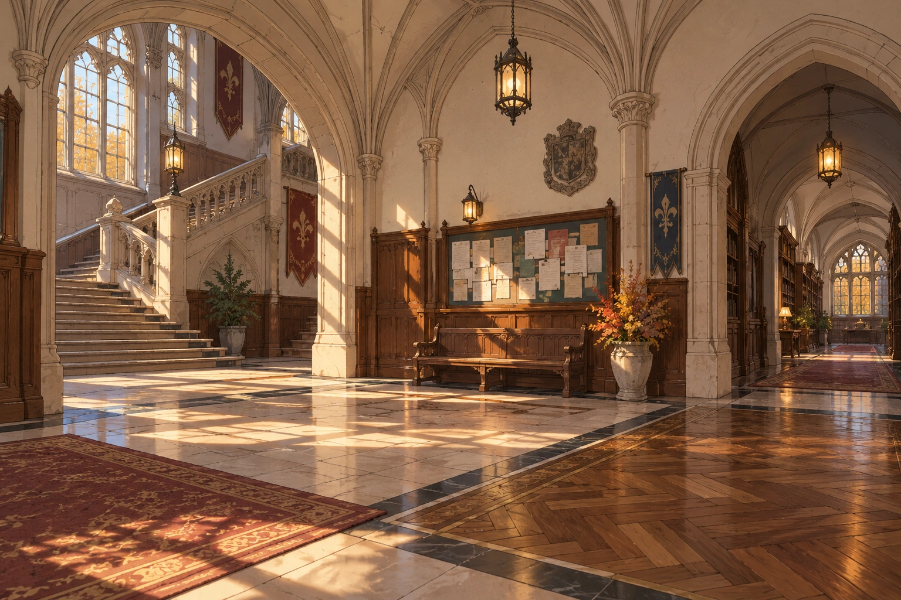 |
| Classroom | 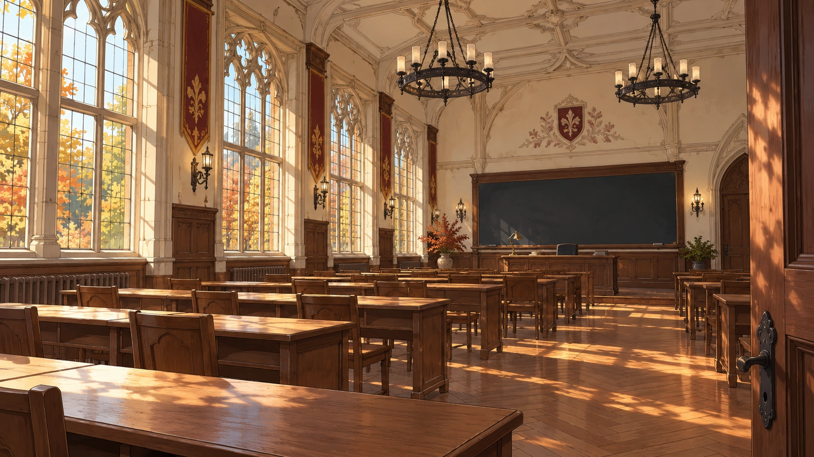 |
| Library | 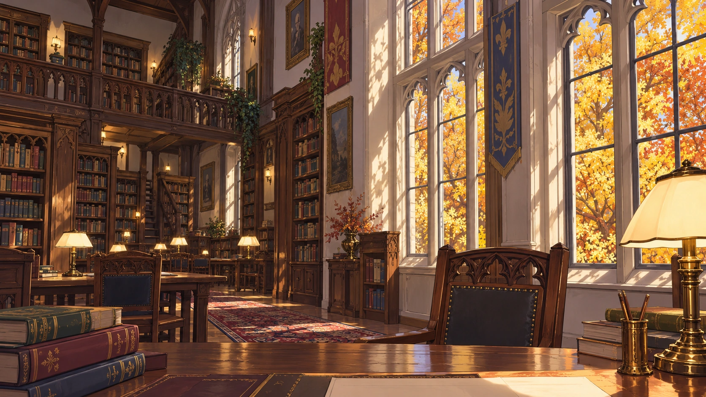 |
| Department office | 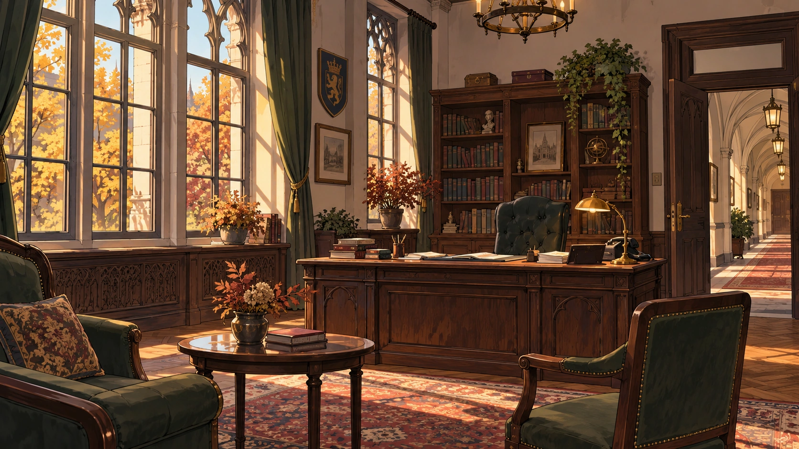 |
| Márton's suite | 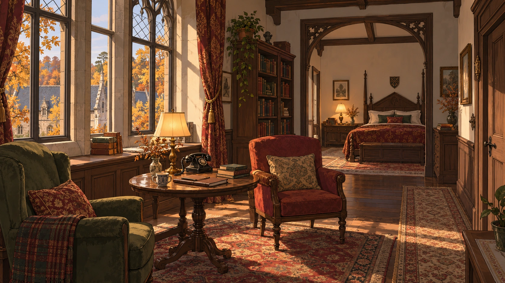 |
| Holdkör | 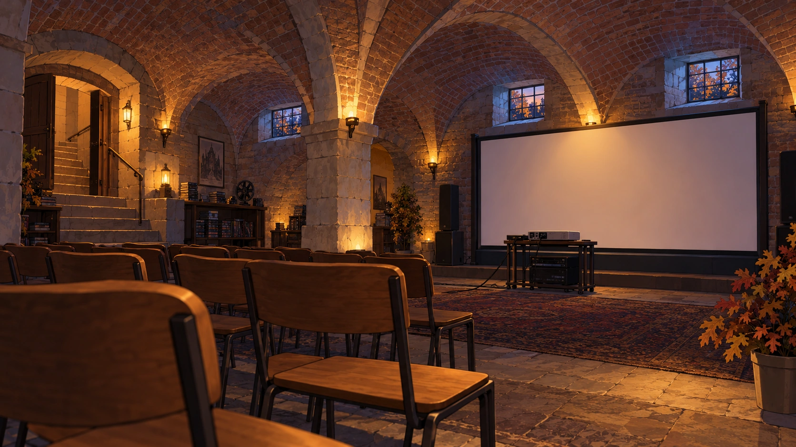 |
| Service chamber | 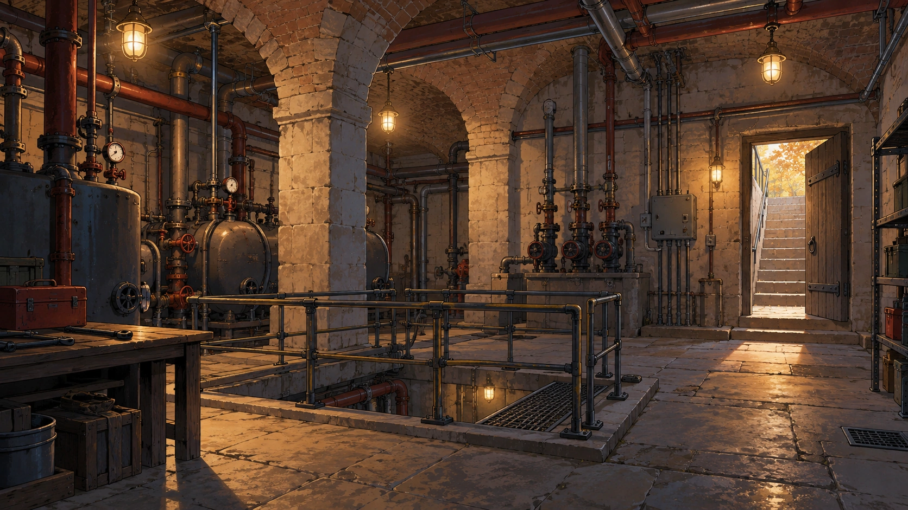 |
| Gatehouse |  |
| Student residences |  |
| Mystical gymnastics workshop | 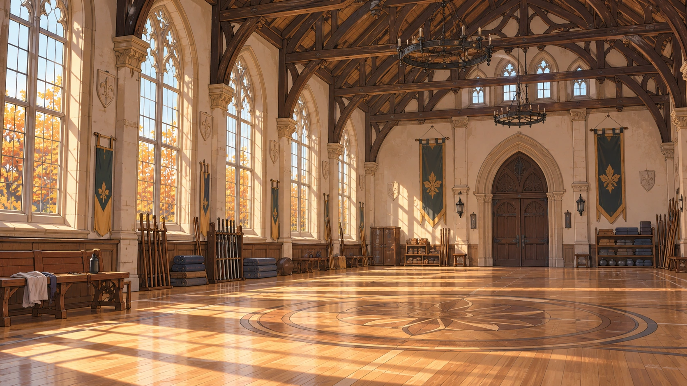 |
| Békás Lake | 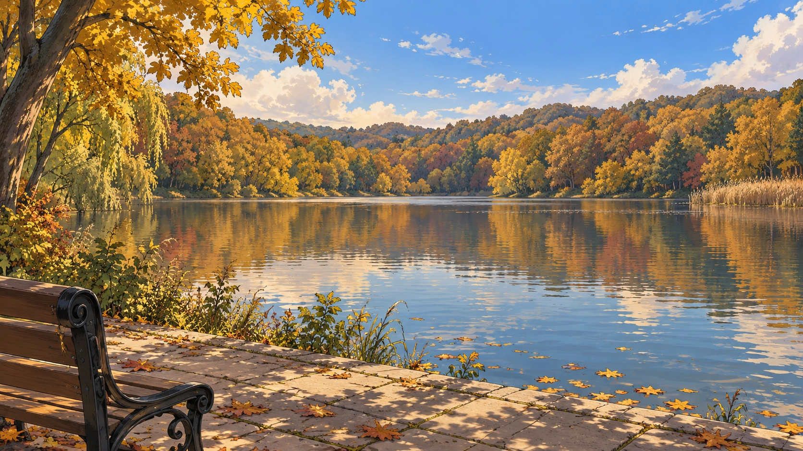 |
| Deep forest |  |
| Ridge lookout | 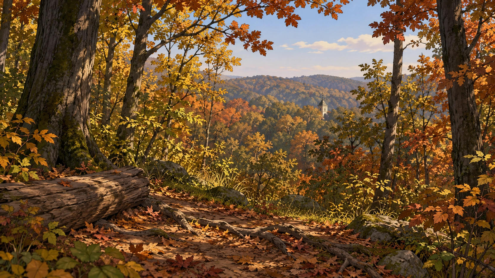 |
| Village | 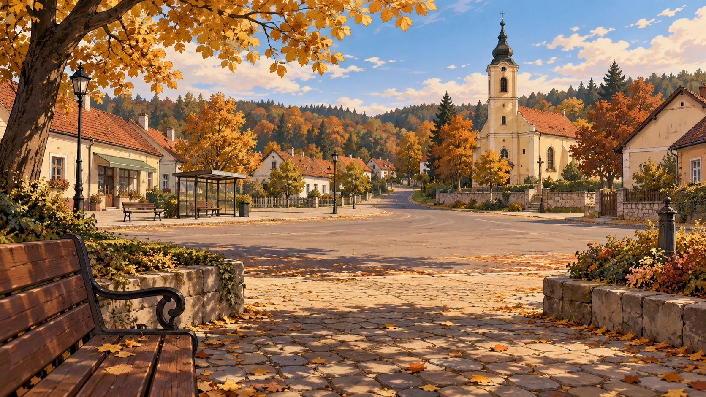 |

## Review and limits

Assistant review checked the generated previews for visible drawn treatment, empty settings and plausible ground-level player viewpoints. Lake, ridge, library, gate and residences received a second spatial pass: oversized/overly elevated castle views were discarded; selected lake looks northeast with castle behind viewer, library windows show trees, gate and residences hide the distant castle, ridge offers a small tower glimpse.

Art is conceptual: exact castle elevations, fenestration, corner details and furniture can still drift between independent illustrations. The suite window shows a nearby estate roof; its definitive riding-hall roof design needs a coordinated production-reference pass. Some environmental decorative busts/heraldic forms are drawn objects, not present characters. The map remains the metric authority; an image does not establish distance. A future production pass needs locked architectural elevations, camera positions, seasonal/time variants, hotspot placement, portrait overlap/mobile checks and user approval before replacing current runtime files. No season matrix, favourite-place decision or new scene registration is claimed complete.
